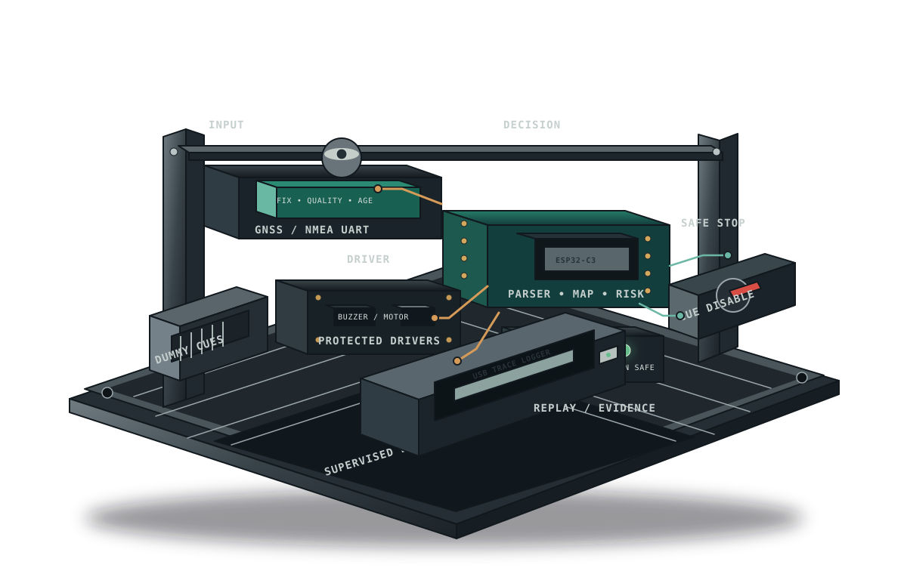
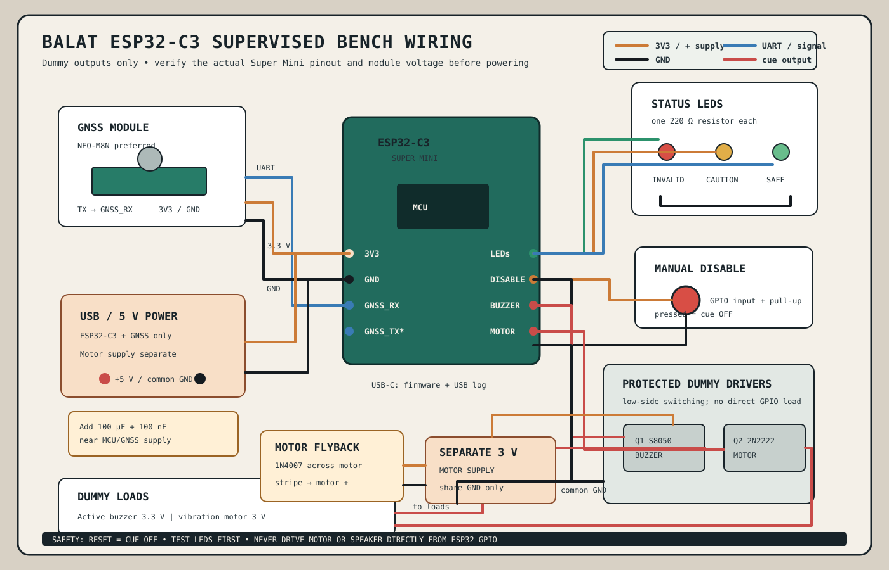

# BALAT ESP32-C3 Bench Prototype

## Purpose

This prototype validates BALAT's GNSS parsing, map-aware risk logic, logging,
and conservative dummy cue behavior before further FPGA integration.

It is a **bench and controlled outdoor data-collection instrument**, not a
production collar. It must not be used to guide animals near live traffic, and
it does not establish animal-guidance effectiveness.

The prototype preserves the existing BALAT contracts:

- invalid, stale, uncertain, or corrupted GNSS data forces `INVALID`;
- the local map is versioned and validated before use;
- road distance uses local metric coordinates and point-to-segment geometry;
- approach is estimated from successive accepted fixes;
- risk states are `INVALID`, `SAFE`, `CAUTION`, `DANGER`, and `COOLDOWN`;
- cue output is bounded, output-only, and disabled on reset or fault;
- HerdSync-DTN cannot authorize or extend a cue;
- every decision is logged and replayable.



**Figure:** The bench rig is the prototype boundary made physical. GNSS enters
from the upper-left tray, the ESP32-C3 performs parsing, map, and risk work,
the protected driver tray controls dummy outputs only, and the USB logger makes
the decision trace reproducible. The red switch is a manual cue disable, not an
animal-control interface.



**Wiring note:** The diagram uses logical signal names such as `GNSS_RX`,
`CUE_BUZZER`, and `CUE_MOTOR`. ESP32-C3 Super Mini boards from different
vendors expose different physical GPIO labels, so map these names to the
specific board's documentation before wiring. Confirm the GNSS UART voltage,
transistor pinout, motor polarity, and diode stripe direction with a multimeter
and the component datasheets.

---

## 1. Prototype scope

### Included

- ESP32-C3 Super Mini firmware.
- GNSS receiver connected over UART.
- USB serial logging and replay control.
- Existing synthetic traces and map fixture.
- Three status LEDs.
- Active buzzer and small vibration motor as **dummy outputs only**.
- Manual disable input.
- Fault injection for stale, corrupt, missing, and implausible fixes.

### Excluded

- Electric shock or painful stimulus.
- Direct GPIO drive of a motor or speaker.
- Animal testing.
- Live-road testing.
- Cellular, Wi-Fi, or BLE dependence in the local risk path.
- Production battery, enclosure, certification, or collision-prevention claims.
- Changes to the v0.1 standalone FPGA architecture.

The ESP32-C3 radio should remain disabled during the local risk tests unless a
separate communications experiment is explicitly configured. Telemetry must
not influence cue authorization.

---

## 2. Minimum bill of materials

The original list is enough for a basic GPIO demonstration, but it is missing
GNSS input and power-protection parts. Use the following minimum BOM.

| # | Component | Qty | Target cost | Purpose |
|---:|---|---:|---:|---|
| 1 | ESP32-C3 Super Mini | 1 | Rp45,000 | MCU, UART, timers, USB serial |
| 2 | GNSS module with antenna, preferably NEO-M8N; NEO-6M acceptable | 1 | — | Position and fix-quality input |
| 3 | Active buzzer, 3.3 V rated | 1 | Rp4,000 | Dummy acoustic output |
| 4 | 3 V vibration motor | 1 | Rp7,000 | Dummy haptic output |
| 5 | S8050 / 2N2222 transistor, or logic-level N-MOSFET | 2 | Rp2,000 | Protected low-side output switching |
| 6 | 1N4007 flyback diode | 1 | Rp1,000 | Motor transient suppression |
| 7 | 1N4148 diode | 1 | optional | Only for a suitable low-current load |
| 8 | 1 kΩ resistors | 2–3 | included | BJT base resistors or signal limiting |
| 9 | 220 Ω resistors | 3 | included | One current-limit resistor per LED |
| 10 | 100 kΩ pulldown resistors | 2 | optional | Keep output drivers inactive during reset |
| 11 | Red, yellow, green LEDs | 3 | Rp2,000 | `INVALID`, `CAUTION`, and `SAFE`/status indication |
| 12 | 100 µF electrolytic capacitor | 1–2 | — | Supply transient buffering |
| 13 | 100 nF ceramic capacitors | 2–4 | — | Local decoupling |
| 14 | Mini breadboard | 1–2 | Rp7,000 | Bench assembly |
| 15 | Jumper wires | 1 set | Rp8,000 | Interconnects |
| 16 | USB-C data cable | 1 | Rp8,000 | Firmware upload and serial logs |
| 17 | Push button or switch | 1 | — | Manual cue disable |
| 18 | External 5 V supply or powered USB hub | 1 | — | Stable supply for GNSS and motor tests |
| 19 | Multimeter | 1 | — | Voltage, polarity, and continuity checks |

Costs are purchasing estimates, not validated production costs. Record actual
vendor, part number, date, and price in the project log.

### Recommended additions

- Logic-level N-MOSFET such as AO3400 or 2N7000 instead of a BJT where
  available.
- Separate GNSS supply filtering.
- USB logic analyser for UART and cue timing.
- External flash or microSD only if the internal replay/log storage is
  insufficient.
- A GNSS simulator or laptop NMEA replay fixture for deterministic tests.

---

## 3. Electrical safety boundary

### Required rules

1. Never connect the vibration motor directly to an ESP32-C3 GPIO.
2. Never connect an unknown buzzer directly to a GPIO; check its current
   rating first.
3. Use a separate protected driver stage for each output.
4. Keep the motor supply physically separate from the GNSS/MCU supply where
   possible, with a shared ground.
5. Add a capacitor close to the ESP32/GNSS supply pins.
6. Confirm all module voltage levels before connecting UART.
7. Reset must leave both cue outputs inactive.
8. Test with LEDs and a logic analyser before enabling the motor.

The prototype output is a dummy load. It must not connect to an animal-mounted
actuator or an unreviewed transducer.

### Low-side BJT motor driver

For an S8050 or 2N2222:

```text
ESP32 GPIO_MOTOR
       |
      1 kΩ
       |
transistor base

transistor emitter  -> common GND
transistor collector -> motor negative
motor positive       -> external motor supply

1N4007 cathode/stripe -> motor positive
1N4007 anode          -> motor negative / collector
```

Use the motor manufacturer's rated voltage. Verify the transistor pinout from
the actual datasheet; S8050 and 2N2222 packages do not always use the same
pin order.

### Buzzer driver

Use the same low-side driver pattern if the buzzer current exceeds the
ESP32-C3 GPIO rating. A 3.3 V active buzzer should turn on when the driver
input is asserted; it does not require PWM for the first prototype.

### Status LEDs

Use one resistor per LED:

```text
ESP32 GPIO -> 220 Ω -> LED anode
LED cathode -> GND
```

Do not share one resistor between multiple LEDs.

---

## 4. Suggested signal assignment

Choose pins from the actual ESP32-C3 Super Mini board documentation before
wiring. The table is a logical assignment, not a claim about a universal
board pinout.

| Signal | Direction | Function |
|---|---|---|
| `GNSS_RX` | MCU input | GNSS TX to MCU hardware UART |
| `GNSS_TX` | MCU output | Optional MCU TX to GNSS; leave disconnected if unused |
| `CUE_BUZZER` | MCU output | Protected buzzer driver input |
| `CUE_MOTOR` | MCU output | Protected motor driver input |
| `LED_INVALID` | MCU output | Invalid/fault indication |
| `LED_CAUTION` | MCU output | Caution indication |
| `LED_SAFE` | MCU output | Safe/status indication |
| `MANUAL_DISABLE` | MCU input | Active-low or active-high, documented in firmware |
| `USB_LOG` | USB serial | Firmware upload and structured logs |

Use internal or external pull resistors only after confirming the reset state.
The firmware must explicitly initialize cue outputs low before enabling any
other output.

---

## 5. Firmware modules

Implement small modules with host-side tests where practical:

```text
board_init
gnss_uart
nmea_parser
fix_quality_gate
coordinate_transform
map_store
nearest_segment
trajectory_estimator
risk_fsm
cue_scheduler
fault_manager
event_log
replay_input
watchdog/reset_reason
```

### Required module behavior

#### `nmea_parser`

- Validate sentence checksum.
- Parse the selected sentence formats.
- Reject malformed fields and impossible coordinates.
- Preserve raw sentence status for debugging.
- Never overwrite the accepted fix with a failed parse.

#### `fix_quality_gate`

- Track fix age and sequence.
- Reject no-fix, stale, backward-time, and implausible-jump records.
- Carry an uncertainty estimate or an explicit unavailable status.
- Force `INVALID` when uncertainty cannot support a safe road comparison.

#### `map_store`

- Load the bounded local-centimetre map fixture.
- Validate map version, record count, coordinate scale, and checksum.
- Reject empty, corrupt, out-of-range, or incompatible maps.
- Keep source, CRS, origin, extraction date, and attribution in the manifest.

#### `nearest_segment`

- Use point-to-segment projection with endpoint clamping.
- Handle zero-length segments.
- Use signed arithmetic and explicit widening for products.
- Return the nearest valid segment and squared distance.

#### `trajectory_estimator`

- Use successive accepted fixes and timestamps.
- Determine toward, away, and near-parallel motion relative to the closest
  road point.
- Avoid relying on GNSS heading at low speed.
- Reject or reduce confidence after jumps or long fix gaps.

#### `risk_fsm`

Use:

```text
INVALID -> SAFE -> CAUTION -> DANGER -> COOLDOWN
```

Apply hysteresis, consecutive-fix confirmation, stale-data handling, and
uncertainty margins. The repository demonstration thresholds are fixtures, not
validated safety limits.

#### `cue_scheduler`

- Reset output off.
- Refuse requests unless state and fix validity permit them.
- Enforce maximum-on duration.
- Enforce a quiet interval between cue starts.
- Respect manual disable.
- Emit start/stop/fault events.

For the first supervised bench profile, use:

- maximum cue duration: 250–500 ms;
- minimum interval between cue starts: 30 seconds;
- one cue output at a time;
- manual disable always available.

---

## 6. Logging format

Send line-oriented CSV or JSONL over USB serial. Every decision should include:

```text
firmware_version
map_version
fix_seq
timestamp
fix_valid
quality
uncertainty_cm
local_x_cm
local_y_cm
nearest_segment_id
distance2_cm2
approaching
risk_state
fault_reason
cue_requested
cue_started
cue_stopped
cue_duration_ms
reset_reason
```

Also support:

```text
BOOT
MAP_OK
MAP_FAULT
GNSS_REJECT
RISK_CHANGE
CUE_START
CUE_STOP
MANUAL_DISABLE
WATCHDOG_RESET
```

Do not log a cue as successful merely because the GPIO was asserted. The log
should say that a cue was requested or output to the dummy load; it must not
claim an animal response.

---

## 7. Reproducible test inputs

Use three input modes:

1. **Live GNSS:** raw NMEA from the receiver.
2. **Serial replay:** recorded NMEA or synthetic local-coordinate trace from a
   host.
3. **Fault injection:** deliberately corrupted checksum, stale timestamp,
   missing fix, jump, uncertainty overflow, and map fault.

For each trace, save:

```text
trace_name
firmware_version
map_version
input_hash
configuration_hash
expected_output_hash
```

Compare observable rows against:

- the Python reference model;
- the ESP32-C3 firmware;
- the future RTL trace player.

The expected result is functional agreement at each sample boundary, within
documented fixed-point tolerance. Clock cycles and UART timing do not need to
be identical.

---

## 8. Test plan

### A. Electrical tests

- Confirm 3.3 V and ground polarity with a multimeter.
- Verify cue GPIOs are low during reset and boot.
- Test each LED with its own resistor.
- Test buzzer driver with the motor disconnected.
- Test motor driver with an LED or resistor dummy load first.
- Add the motor only after serial logging remains stable.
- Verify the motor cannot reset the MCU or corrupt GNSS logging.

### B. Parser and fault tests

- Valid NMEA sentence.
- Bad checksum.
- Truncated sentence.
- Malformed latitude/longitude.
- No-fix status.
- Stale fix.
- Backward timestamp.
- Missing UART stream.
- Implausible position jump.
- Excessive uncertainty.

Expected result: `INVALID`, cue outputs off, and an explicit log reason.

### C. Geometry tests

- Point on a segment.
- Point before an endpoint.
- Point after an endpoint.
- Zero-length segment.
- Parallel and perpendicular approaches.
- Nearest-segment tie.
- Maximum coordinate values.
- Negative local coordinates.
- Product and accumulator overflow boundaries.

Expected result: agreement with the Python reference within the configured
tolerance and no silent wraparound.

### D. Risk and scheduler tests

- `INVALID` to `SAFE` after valid-fix confirmation.
- `SAFE` to `CAUTION`.
- `CAUTION` to `DANGER`.
- Hysteresis on the way out.
- `DANGER` to `COOLDOWN`.
- Cooldown suppresses repeated requests.
- Maximum cue duration terminates output.
- Manual disable suppresses output.
- Reset during cue turns output off.
- Map fault turns output off.
- GNSS fault during cue turns output off.

### E. Replay comparison

Run the same trace through the Python model, ESP32-C3 replay mode, and RTL
reference. Compare:

- accepted/rejected fix;
- local coordinates;
- nearest segment;
- squared distance;
- approach flag;
- risk state;
- cue request;
- cue start/stop timing at the configured sample boundary.

---

## 9. Suggested one-week schedule

| Day | Work | Exit evidence |
|---|---|---|
| 1 | Assemble ESP32, LEDs, USB logging, reset-safe outputs | Boot log and all outputs inactive on reset |
| 2 | Connect GNSS UART and implement parser/quality gate | Valid, bad-checksum, no-fix, and stale tests |
| 3 | Port map fixture, manifest validation, and geometry | Python/MCU distance comparison |
| 4 | Add velocity, approach estimator, and risk FSM | Toward/away/parallel and hysteresis replay |
| 5 | Add protected buzzer/motor dummy drivers and scheduler | Duration, cooldown, disable, and fault tests |
| 6 | Add deterministic replay and structured trace comparison | MCU/Python/RTL result table |
| 7 | Run bench soak, prepare demo, write evidence report | Go/no-go decision for next FPGA milestone |

Do not spend the week on wireless integration before the local path and fault
behavior are reproducible.

---

## 10. Demonstration script

1. Show the ESP32-C3, GNSS module, LEDs, driver stage, and manual disable.
2. Confirm that no real actuator is connected.
3. Display firmware version and map manifest checksum.
4. Replay a safe trace and show `SAFE` with no cue.
5. Replay an approach trace and show `CAUTION`, `DANGER`, then one bounded
   buzzer/LED output.
6. Replay an away trace and show hysteresis and cooldown behavior.
7. Inject bad checksum, stale fix, no-fix, and map-fault cases.
8. Show `INVALID`, cue-off, and explicit fault reasons.
9. Reset during an active dummy cue and show immediate output shutdown.
10. Compare one trace row between Python, MCU, and RTL.
11. State clearly: this demonstrates bench behavior, not animal guidance or
    accident prevention.

---

## 11. Definition of done

The ESP32-C3 prototype is complete when:

- the selected GNSS module is identified and its UART voltage is verified;
- valid NMEA input is parsed and logged;
- invalid, stale, missing, corrupt, uncertain, and implausible inputs force
  `INVALID` and cue-off;
- the existing local map fixture loads only after manifest validation;
- geometry results match the Python reference for the required edge cases;
- toward, away, and parallel traces produce the expected approach state;
- risk-state transitions and hysteresis are covered by replay tests;
- buzzer and motor outputs use protected drivers and never direct GPIO power;
- reset, watchdog, brownout simulation, map fault, and manual disable leave
  outputs inactive;
- maximum duration and 30-second cooldown are demonstrated;
- USB logs explain every risk and cue decision;
- at least one multi-hour bench soak completes without unexplained resets or
  corrupt logs;
- a comparison report records MCU/Python/RTL differences;
- no claim of animal response, road-safety effectiveness, or production
  readiness is made.

---

## 12. Next decision

Continue the FPGA implementation only if:

1. MCU, Python, and RTL decisions agree reproducibly.
2. GNSS uncertainty and map completeness can be measured for a target corridor.
3. The cue scheduler remains safe under all injected faults.
4. Customer discovery identifies a responsible pilot operator and buyer.
5. Welfare review supports a supervised, enclosed, non-aversive behavioral
   protocol.
6. Deterministic RTL offers a justified benefit over a low-power MCU for the
   next stage.

If the ESP32-C3 is sufficient for the product need, retain the FPGA as a
verification/reference platform and revisit the production architecture rather
than assuming custom RTL is required.
