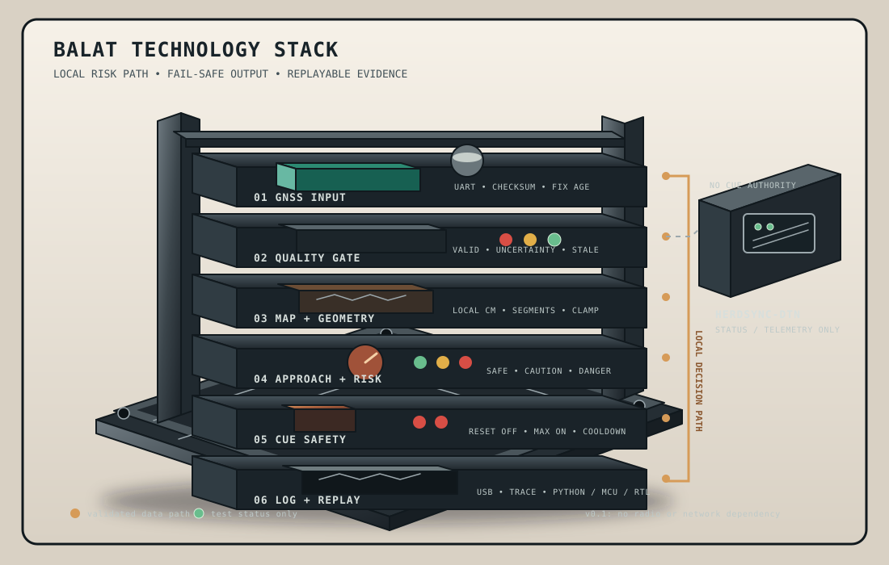
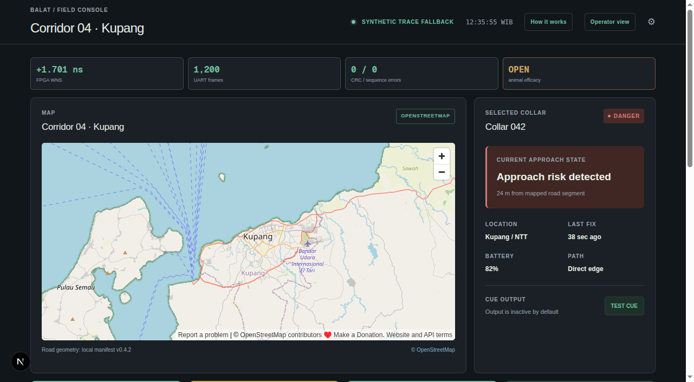

# BALAT — Offline Road-Risk Validation for Free-Grazing Livestock

## Investor pitch deck — evidence-safe master version

**Stage:** Pre-seed validation / research prototype  
**Primary decision:** Should BALAT earn the next validation tranche?  
**Current evidence:** RTL simulation, synthetic trace replay, FPGA bench testing,
HerdSync-DTN software scenarios, and a one-week MCU validation plan  
**Not yet demonstrated:** reliable animal response, field safety, production
power/runtime, map completeness, paying-customer demand, or accident prevention

> **Claims discipline:** This deck separates measured evidence, engineering
> targets, and business hypotheses. BALAT is not presented as a proven virtual
> fence and is not a substitute for fencing, supervision, or traffic controls.

---

## Slide 1 — The decision we are testing

### Can a local, conservative road-risk engine become a useful validation
instrument for livestock managers in connectivity-poor areas?

BALAT combines:

- GNSS position and quality checks;
- locally stored, map-aware road geometry;
- deterministic approach-risk computation;
- bounded, output-only cue requests;
- replayable logs that explain every decision.

The first product question is not whether the FPGA can calculate distance. It
can. The first product question is whether the complete system can operate
reliably enough, safely enough, and with an ethically acceptable cue protocol
to justify a supervised behavioral study.

**Speaker note:** We are funding evidence, not claiming a finished collar.

---

## Slide 2 — The narrow customer problem

### Some grazing operations manage cattle near known roads without dependable
fencing, cellular coverage, or continuous supervision

The initial wedge is deliberately narrow:

> A cooperative, district livestock program, or managed farmer group with
> free-grazing cattle near a documented road corridor and a responsible
> on-site supervisor.

The operational pain to validate:

- a road corridor is known to the operator;
- animals can approach it from a grazing area;
- fencing or supervision is incomplete, expensive, or difficult to maintain;
- a passive tracker reports location but does not locally evaluate approach risk;
- network coverage cannot be assumed at the point of risk.

**Evidence still required:** incident history, fencing alternatives, site
coverage, buyer authority, budget, and a written pilot commitment.

---

## Slide 3 — Why this wedge is difficult

| Constraint | Why it matters |
|---|---|
| GNSS uncertainty | A road centerline is not a road edge; multipath and canopy can move the apparent position. |
| Incomplete maps | Private roads, farm tracks, new access points, and road width may be absent or wrong. |
| Animal behavior | A non-aversive cue may be ignored, habituated to, or produce an unsafe response. |
| Connectivity gaps | A local decision cannot wait for cloud, cellular, or a fixed gateway. |
| Welfare and liability | A cue must be bounded, supervised, non-painful, and stopped if distress or unsafe movement appears. |
| Economics | Hardware BOM is not the same as fully loaded deployment cost or customer willingness to pay. |

These are validation workstreams, not hidden assumptions.

---

## Slide 4 — The proposed product direction

### A local road-risk engine plus a supervised cue experiment

1. Receive and validate a GNSS fix.
2. Reject invalid, stale, uncertain, or implausible data.
3. Convert the accepted position to local metric coordinates.
4. Compare the position with a finite, versioned road map.
5. Estimate movement toward the nearest relevant segment.
6. Enter a conservative risk state with hysteresis.
7. Request a bounded cue through an external protected interface.
8. Log the inputs, decision, faults, and cue timing.

The cue is experimental. It is not assumed to tell cattle which direction to
move, and it is not assumed to prevent road entry.

---

## Slide 5 — Product architecture

```text
GNSS UART
   |
   v
Fix parser + checksum + quality gate
   |
   v
Local coordinate transform
   |
   v
Versioned road map in local storage
   |
   v
Nearest segment + point-to-segment distance
   |
   v
Velocity + approach estimator
   |
   v
INVALID / SAFE / CAUTION / DANGER / COOLDOWN
   |
   v
Conservative cue scheduler
   |
   +--> LED / logic analyser / protected-driver input
   |
   +--> Structured event log + replay trace

HerdSync-DTN
   |
   +--> status and telemetry only
        never cue authorization
```



**Figure meaning:** The clean rack makes the local decision path physical:
GNSS and quality checks enter at the top, map geometry and risk state sit in
the middle, cue safety and replay logging close the path, and the HerdSync-DTN
pod is visibly separate. Green indicators are test status only; no real
speaker, motor, or animal trial is connected.

---

## Slide 6 — What is technically differentiated

BALAT's proposed technical wedge is a combination, not a single patented claim:

- **Offline operation:** the local risk path does not require a live network.
- **Map-aware risk:** distance is measured against road geometry rather than a
  circular geofence alone.
- **Uncertainty-aware fail-safe behavior:** bad or stale inputs suppress cues.
- **Output-only modularity:** the risk engine does not depend on a specific
  transducer or feedback protocol.
- **Reproducibility:** the same trace can be evaluated by Python, MCU, and RTL.
- **DTN separation:** HerdSync-DTN can exchange status without authorizing a cue.

These become defensible only if field data, deployment practice, and welfare
evidence are earned.

---

## Slide 7 — Current evidence

### Bench proof, not field or animal proof

| Evidence | Status | What it proves |
|---|---|---|
| Synthesizable road geometry and risk RTL | Measured | The bounded digital pipeline can be implemented on Basys 3. |
| Synthetic local-coordinate replay | Measured | Known trajectories produce repeatable geometry and risk decisions. |
| Python reference comparisons | Measured | Selected fixed-point geometry vectors agree within documented tolerance. |
| Basys 3 implementation | Measured | Demonstration path met timing; reported WNS was +1.701 ns. |
| USB-UART bridge | Measured | A separate bridge streamed 1,200 frames over 120 seconds with no recorded sequence gaps or CRC errors. |
| HerdSync-DTN scenarios | Measured | Software store-carry-forward scenarios passed their current test suite. |
| Live collar GNSS | Not measured | Antenna placement, canopy, motion, and multipath remain open. |
| Cue response | Not measured | No animal behavior or guidance efficacy claim is supported. |

**Sources:** [`PRODUCT_CONTEXT.md`](../PRODUCT_CONTEXT.md),
[`PLAN.md`](../PLAN.md), [`docs/VERIFICATION.md`](../docs/VERIFICATION.md),
[`docs/SAFETY_AND_LIMITATIONS.md`](../docs/SAFETY_AND_LIMITATIONS.md).

---

## Slide 8 — The existential assumption

### Will livestock respond reliably and safely to non-aversive cues?

Unknowns:

- whether acoustic or haptic cues can be conditioned without painful
  reinforcement;
- whether response persists after repeated exposure;
- whether a cue causes stopping, turning, approach, startle, or no response;
- whether response varies by animal, breed, terrain, weather, and context;
- whether the cue could create a new road hazard.

**Stop rule:** halt a study for distress, panic, unsafe movement, worsening
habituation, or any sign that the cue is not welfare-compatible.

No animal work begins without appropriate welfare review, trained supervision,
an enclosed safe area, positive conditioning, predefined metrics, and a manual
disable path.

---

## Slide 9 — One-week validation sprint

| Day | Deliverable | Decision evidence |
|---|---|---|
| 1 | STM32L476RG Nucleo, GNSS UART, USB console, reset-safe LED output, event schema | Board can capture and log without enabling a real actuator. |
| 2 | NMEA parser, checksum validation, fix-quality gate, stale handling | Invalid and stale input never becomes an accepted fix. |
| 3 | Map manifest validation, local centimetre coordinates, nearest-segment geometry | MCU agrees with Python vectors and rejects bad maps. |
| 4 | Velocity, approach detection, jump rejection, risk FSM | Toward/away/parallel and hysteresis cases match the contract. |
| 5 | Cue scheduler, manual disable, fault manager, structured log | Duration and quiet interval are enforced under faults. |
| 6 | Deterministic replay and MCU/Python/RTL comparison | The same trace yields the same observable decisions. |
| 7 | Supervised bench demo, evidence report, continuation gate | Team decides whether FPGA work earns the next tranche. |

This sprint excludes animal testing, production hardware, radio integration, and
real actuators.

---

## Slide 10 — Why MCU-first now, FPGA-first later

### Use the MCU to answer product questions the FPGA cannot answer efficiently

The STM32L476RG Nucleo is recommended because it provides:

- hardware UART and timers;
- watchdog, brownout, and reset support;
- enough memory for the current map and replay logs;
- fixed-point arithmetic suitable for RTL comparison;
- low-power modes relevant to a future wearable;
- USB serial for transparent, reproducible logs;
- a fast path to GNSS, power, enclosure, and outdoor trace collection.

The MCU is a validation instrument, not an architecture replacement. The
standalone FPGA remains the deterministic RTL reference for v0.1.

---

## Slide 11 — GNSS quality and uncertainty

An accepted fix must include:

```text
fix_seq, timestamp, latitude, longitude
local_x_cm, local_y_cm
fix_valid, quality, uncertainty_cm
received_at, parser_status
```

Reject or force `INVALID` when:

- checksum or sentence parsing fails;
- receiver reports no fix;
- fix age exceeds the configured limit;
- timestamps move backward;
- position jumps beyond a documented plausible speed;
- uncertainty is larger than the configured road buffer;
- the coordinate is outside the map origin/range;
- the GNSS stream stops or the MCU resets.

GNSS heading alone is insufficient at low speed. Approach is derived from
successive accepted fixes and a vector toward the nearest road point.

---

## Slide 12 — Road-segment and map contract

Each bounded segment record preserves the existing repository contract:

```text
segment_id
ax_cm, ay_cm
bx_cm, by_cm
ux_q14, uy_q14
road_class
buffer_cm
valid
```

The manifest records:

- source and applicable ODbL attribution;
- extraction timestamp and map version;
- bounding box, CRS, and local origin;
- simplification tolerance;
- coordinate unit, signed width, and direction format;
- segment count and configured maximum;
- checksum and manual-correction status.

Road class is not treated as traffic danger by itself. A road buffer requires
local verification, and missing/private roads need a manual correction path.

---

## Slide 13 — Distance and approach calculation

For animal point `P` and road segment `A-B`:

```text
v = B - A
w = P - A
t = clamp(dot(w, v) / dot(v, v), 0, 1)
Q = A + t*v
distance_squared = dot(P-Q, P-Q)
```

Implementation rules:

- use signed, documented fixed-point coordinates in centimetres;
- compare squared distances where a square root is unnecessary;
- clamp projections to segment endpoints;
- handle zero-length segments explicitly;
- guard multiplication, accumulation, and narrowing overflow;
- scan the bounded map and retain the nearest valid segment;
- compare MCU and RTL results against the Python reference.

The current demonstration thresholds are engineering fixtures, not safety
calibration: CAUTION enter 500 cm / exit 600 cm; DANGER enter 200 cm / exit
300 cm.

---

## Slide 14 — Risk state machine

```text
                 invalid / stale / map fault
                         +----------------+
                         v                |
                      INVALID             |
                         |                |
                         v                |
 SAFE <---- hysteresis ----> CAUTION ----> DANGER
  ^                             ^             |
  |                             |             v
  +--------- cooldown ----------+--------- COOLDOWN
```

Required states:

- `INVALID`: no trustworthy position or map.
- `SAFE`: no confirmed approach.
- `CAUTION`: approach within the configured outer buffer.
- `DANGER`: approach meets the configured inner condition.
- `COOLDOWN`: a cue was issued and repeat is inhibited.

Transitions use consecutive-fix confirmation, hysteresis, uncertainty
margins, stale-data watchdogs, and manual disable.

---

## Slide 15 — Cue scheduler and safety boundary

The cue scheduler is deliberately conservative:

- output-only `CUE_EN` and optional control signal;
- inactive on reset, watchdog recovery, brownout, invalid fix, stale fix,
  invalid map, or manual disable;
- hard maximum cue duration;
- mandatory quiet interval between cue starts;
- explicit `cue_requested`, `cue_started`, `cue_stopped`, and fault events;
- LED, logic analyser, or protected driver input only during the prototype.

The existing RTL demonstration uses a 10 Hz tick, a 0.5-second maximum, and a
3-second cooldown. The one-week MCU behavior profile should use a stricter
supervised profile: 250–500 ms maximum and at least 30 seconds between cue
starts unless a welfare-reviewed protocol explicitly changes it.

No GPIO directly powers a motor or speaker.

---

## Slide 16 — Logging makes the product auditable

Every decision is associated with:

```text
firmware_version, map_version, fix_seq, timestamp
fix_valid, quality, uncertainty, local_x_cm, local_y_cm
nearest_segment_id, distance2_cm2, approaching, risk_state
fault_reason, cue_requested, cue_started, cue_stopped
cue_duration_ms, reset_reason
```

Logs are:

- line-oriented CSV or JSONL over USB serial;
- versioned with the firmware and map manifest;
- accompanied by raw GNSS where privacy and storage policy permit;
- replayable without live hardware;
- diffable against Python and RTL expected traces.

The goal is functional agreement at each sample boundary, not identical clock
latency.

---

## Slide 17 — HerdSync-DTN boundary

HerdSync-DTN is a separate status and telemetry track:

- peer records can be stored, carried, exchanged, authenticated, and
  summarized;
- a phone can act as a data mule;
- records can expose device status, battery, last fix, and risk state;
- communication loss must not disable the local safety state machine;
- peer packets, phone commands, and remote configuration cannot authorize,
  extend, or retrigger a cue;
- configuration changes are versioned, validated, and applied atomically.

This boundary preserves the v0.1 architecture and prevents a network path from
becoming a hidden safety dependency.

---

## Slide 18 — Demo script

### A seven-minute evidence-safe demonstration

1. **Show the hardware:** STM32 board, GNSS simulator or recorded input,
   USB cable, LED/dummy load, and manual disable switch.
2. **Load the manifest:** display map version, CRS/origin, segment count, and
   checksum.
3. **Replay a safe trace:** show accepted fixes, nearest segment, distance,
   `SAFE`, and no cue.
4. **Replay an approach:** show `CAUTION`, then `DANGER`, then one bounded LED
   pulse.
5. **Replay an away trajectory:** show risk returning through hysteresis without
   a repeated cue.
6. **Inject stale/corrupt/no-fix input:** show `INVALID` and cue-off.
7. **Trigger a map fault and reset:** show safe boot and inactive output.
8. **Compare one trace:** display matching Python, MCU, and RTL state rows.
9. **State the limitation:** this proves deterministic bench behavior only; it
   does not prove animal guidance or road-safety effectiveness.

---

## Slide 19 — Business model hypothesis

### Start with a paid validation and deployment service

Initial offer hypothesis:

- supervised site assessment and map preparation;
- a limited device pilot;
- installation, configuration, training, and support;
- offline operation without a mandatory live-network subscription;
- optional annual service for map updates, device management, data export, and
  risk reports.

The earlier target assumptions are placeholders:

- hardware target: Rp 2,400,000 per device;
- annual service target: Rp 500,000 per active device.

Before pricing is adopted, measure:

- willingness to pay and budget owner;
- pilot-to-paid conversion;
- installation and support hours;
- device loss, repair, and replacement;
- map-maintenance effort;
- service attach and renewal intent;
- customer value of logs and risk reports.

---

## Slide 20 — TAM / SAM / SOM model

### A bottom-up model, not an unsupported global headline

Define:

```text
Eligible cattle = cattle near target road corridors
TAM hardware = eligible cattle × device ASP
SAM hardware = reachable eligible cattle × realistic segment coverage × device ASP
SOM hardware = first-three-year deployments × device ASP
Service revenue = active devices × attach rate × annual service price × renewal rate
```

### Illustrative scenario for model review — not a market estimate

| Layer | Input assumptions | Implied hardware value |
|---|---|---:|
| TAM scenario | 100,000 eligible cattle × Rp 2.4m ASP | Rp 240.0bn |
| SAM scenario | 20,000 reachable cattle × 50% segment coverage × Rp 2.4m | Rp 24.0bn |
| SOM scenario | 500 deployed devices in first three years × Rp 2.4m | Rp 1.2bn |

Illustrative recurring service at 500 active devices:

```text
500 × 80% attach × Rp 500,000 = Rp 200m annual service revenue
before renewal, support, installation, and payment-timing adjustments
```

These figures are scenario math only. Replace every population and coverage
input with sourced regional counts, corridor screening, buyer interviews, and
pilot conversion evidence. The model must reconcile eligible cattle, 15,000
versus 25,000 deployment claims, pricing, attach rate, renewal, and fully
loaded costs before being used in an investment forecast.

---

## Slide 21 — Unit economics to validate

### Component BOM is not gross margin

The current component target is approximately Rp 480,000 at a 10,000-volume
estimate, but that is not a validated production COGS.

The financial model must separately include:

- GNSS, compute, radio, battery, enclosure, PCB, and assembly;
- map preparation, installation, and configuration;
- testing, calibration, packaging, freight, warranty, and repair;
- support, field operations, replacements, and payment fees;
- tooling, certification, inventory, working capital, and pilot discounts.

Example arithmetic checks:

- 5,000 × Rp 2.4m = Rp 12.0bn hardware revenue.
- 5,000 × Rp 500k = Rp 2.5bn annual service revenue before attach/renewal.
- 25,000 × Rp 2.4m = Rp 60.0bn hardware revenue.
- 25,000 × Rp 500k = Rp 12.5bn annual service revenue before attach/renewal.

No gross-margin or cash-flow claim is made until these costs are measured.

---

## Slide 22 — Competition and positioning

| Approach | Strength | Open limitation for this wedge |
|---|---|---|
| Physical fencing | Direct boundary | Cost, terrain, maintenance, and access |
| Human supervision | Flexible | Limited coverage and response time |
| Passive tracking | Location visibility | Does not necessarily make a local approach decision |
| Connected virtual fencing | Existing commercial workflows | Connectivity, subscription, cue protocol, and local-fit questions require product-by-product verification |
| BALAT prototype | Offline local decision path and replaceable output | GNSS, maps, animal response, economics, and field reliability remain unvalidated |

Do not claim BALAT is the only offline, humane, or infrastructure-free
approach. Verify each competitor's current hardware, network, cue, pricing, and
welfare claims before publishing a comparison.

---

## Slide 23 — Defensibility path

Potential future advantages must be earned:

1. Field-calibrated road-risk and GNSS datasets from difficult rural corridors.
2. A map correction and deployment workflow for missing/private roads.
3. Evidence-backed stale-data and uncertainty policies.
4. Welfare-reviewed cue-conditioning protocols and stop criteria.
5. Reliable operations in connectivity-poor environments.
6. Trusted integrations with cooperatives, veterinary partners, and district
   programs.
7. A reproducible validation stack that makes safety and failure behavior
   inspectable.

The current RTL and anatomy visual are engineering assets, not a patent moat.

---

## Dashboard evidence snapshot



**Figure:** The dashboard is a read-only presentation layer for bench
telemetry and synthetic replay. It exposes the map/risk state, replay controls,
evidence metrics, and the explicit open question around animal efficacy. It
does not send FPGA commands or claim animal-guidance effectiveness.

---

## Slide 24 — Stage-gated roadmap

### Fund evidence in the order that reduces risk

**Gate 0 — Deterministic bench behavior**

- Python, MCU, and RTL agree on parser, geometry, risk, and cue decisions.
- Invalid, stale, uncertain, corrupt, and map-fault cases fail safe.

**Gate 1 — GNSS and map performance**

- Collar or dummy-harness GNSS logging in open sky, canopy, and built-up areas.
- Measured uncertainty, outage, jump, latency, and map completeness.

**Gate 2 — Welfare-reviewed behavioral study**

- Enclosed safe area, positive conditioning, non-aversive cue, trained staff,
  predefined response and habituation metrics, and stop rules.

**Gate 3 — Customer and operations validation**

- Named pilot partner, installation workflow, support burden, buyer authority,
  willingness to pay, and renewal intent.

**Gate 4 — Limited supervised field pilot**

- Only after previous gates pass; no accident-prevention claim without robust
  evidence.

Failure at any gate triggers a pause or pivot rather than automatic scale-up.

---

## Slide 25 — Funding ask

### Fund the next decision, not a national rollout

The first tranche should cover:

- one-week MCU behavior and safety prototype;
- GNSS field logging and map validation;
- customer discovery and pilot-site assessment;
- welfare and veterinary protocol preparation;
- protected dummy-output fixtures and reproducible trace tooling;
- independent review of safety, claims, and data handling.

Milestone-based release:

1. Release for deterministic MCU/RTL agreement.
2. Release for GNSS/map evidence if Gate 0 passes.
3. Release for welfare-reviewed behavioral work only if the protocol and stop
   criteria are approved.

The funding amount should be derived from quotations and staff time, not from a
target valuation or an assumed device-volume forecast.

---

## Slide 26 — Risks and mitigations

| Risk | Mitigation | Gate |
|---|---|---|
| Cue ignored or habituated | Welfare-reviewed positive conditioning; stop and pivot if response is unsafe or absent | 2 |
| GNSS uncertainty crosses road edge | Log uncertainty, use conservative margins, suppress cues when ambiguous | 1 |
| Map misses a road | Source manifest, local survey, manual corrections, versioned rollback | 1 |
| Cue chatter or distress | Hysteresis, hard duration, long cooldown, manual disable, dummy-load testing | 0/2 |
| Radio becomes hidden dependency | HerdSync status-only boundary and fault-injection tests | 0 |
| Development hardware misleads power claims | Measure regulators, USB, LEDs, GNSS, and duty cycle separately | 1 |
| BOM is mistaken for margin | Fully loaded COGS and operations model | 3 |
| Pilot has no buyer or supervisor | Require named owner, site assessment, and written protocol | 3 |
| Investor overclaim | Evidence labels, source links, and explicit unknowns on every slide | All |

---

## Slide 27 — Definition of done for the next tranche

The next tranche is complete when:

- a reproducible repository commit builds the MCU replay harness;
- Python, MCU, and RTL agree on the documented trace set;
- stale, missing, corrupt, uncertain, implausible, and spoof-like inputs force
  `INVALID` and cue-off;
- the map manifest and correction workflow are exercised;
- the dummy output remains bounded across reset, watchdog, brownout simulation,
  manual disable, and cooldown cases;
- USB logs contain enough context to explain every risk and cue decision;
- at least one GNSS data-collection protocol is ready for the target site;
- a customer discovery report names the buyer, operator, site, budget signal,
  and unresolved objection;
- no animal or real-actuator claim is made from bench evidence.

---

## Slide 28 — What remains out of scope

This deck does not authorize:

- electric shock or painful stimulus;
- direct motor/speaker drive from FPGA or MCU pins;
- unsupervised animal testing;
- live-road testing during early validation;
- a production collar or production battery-life claim;
- automatic map updates from an untrusted network;
- movement classification without a concrete requirement and dataset;
- a CPU, SoC, operating system, or network stack in the v0.1 RTL safety path;
- a claim that BALAT reliably steers cattle or prevents collisions.

---

## Slide 29 — Why continue to FPGA?

Continue the FPGA implementation only if the MCU sprint shows:

1. The observable contracts are stable and worth hardening.
2. Fixed-point geometry and risk decisions are reproducible.
3. GNSS/map uncertainty can be bounded for a target corridor.
4. Cue scheduling is safe as a replaceable output request.
5. The product hypothesis survives customer and welfare review.
6. Power, memory, latency, and update requirements justify deterministic RTL
   over a low-power MCU.

If the MCU meets the product need at lower power and cost, retain FPGA as a
verification/reference platform and reconsider production silicon. If behavioral
or customer validation fails, stop expanding the RTL pipeline.

---

## Slide 30 — Closing

### BALAT is a disciplined test of a hard problem

The near-term proposition is modest:

> Build an offline, map-aware road-risk instrument that fails safe, explains
> its decisions, and earns the right to test a humane cue protocol.

The next proof is not a louder buzzer or a larger market headline. It is:

- deterministic agreement across Python, MCU, and RTL;
- measured GNSS and map performance;
- a welfare-reviewed behavioral protocol;
- a named customer with a credible pilot path.

If those gates pass, BALAT may justify a production architecture. If they do
not, the project will have learned early and safely.

---

## Appendix A — Repository contracts to preserve

| Contract | Preserve |
|---|---|
| GNSS | UART framing, checksum, fix validity, fix age, malformed input rejection |
| Coordinates | Local projected East/North coordinates, documented signed fixed-point units |
| Map | Bounded segment records, manifest, checksum/version, ODbL attribution, manual correction |
| Geometry | Point-to-segment projection, endpoint clamp, zero-length handling, overflow guards |
| Approach | Successive accepted fixes, velocity, vector-to-road, low-speed caution |
| Risk | `INVALID`, `SAFE`, `CAUTION`, `DANGER`, `COOLDOWN`, hysteresis, stale/map fail-safe |
| Cue | Output-only MCI, reset inactive, maximum duration, quiet cooldown |
| HerdSync-DTN | Status/telemetry only; no cue authorization or extension |
| Verification | Python reference, synthetic traces, RTL tests, MCU replay, FPGA bench evidence |

---

## Appendix B — Source map

- [`PRD.md`](../PRD.md) — goals, non-goals, and acceptance criteria.
- [`ARCHITECTURE.md`](../ARCHITECTURE.md) — standalone RTL and extension boundaries.
- [`PLAN.md`](../PLAN.md) — milestones and current evidence.
- [`docs/INTERFACES.md`](../docs/INTERFACES.md) — data and cue contracts.
- [`docs/VERIFICATION.md`](../docs/VERIFICATION.md) — test and comparison strategy.
- [`docs/MICROCONTROLLER_PROTOTYPE.md`](../docs/MICROCONTROLLER_PROTOTYPE.md) —
  MCU runbook.
- [`docs/SAFETY_AND_LIMITATIONS.md`](../docs/SAFETY_AND_LIMITATIONS.md) —
  welfare and claims rules.
- [`data/road_manifest.json`](../data/road_manifest.json) — current map metadata.
- [`data/road_segments.csv`](../data/road_segments.csv) — current map fixture.
- [`data/demo_trace.csv`](../data/demo_trace.csv) — replay input.
- [`data/demo_trace_expected.csv`](../data/demo_trace_expected.csv) — expected output.
- [`rtl/road_geom.v`](../rtl/road_geom.v) — point-to-segment implementation.
- [`rtl/nearest_segment.v`](../rtl/nearest_segment.v) — nearest-segment scan.
- [`rtl/velocity_estimator.v`](../rtl/velocity_estimator.v) — approach estimator.
- [`rtl/risk_fsm.v`](../rtl/risk_fsm.v) — risk state logic.
- [`rtl/cue_scheduler.v`](../rtl/cue_scheduler.v) — bounded cue scheduling.

---

## Appendix C — One-line investor summary

BALAT is validating whether a low-power, offline, map-aware road-risk engine
can be operated safely and economically around free-grazing livestock; the
company earns the right to claim a product only after deterministic bench,
GNSS/map, welfare, and customer gates pass.
