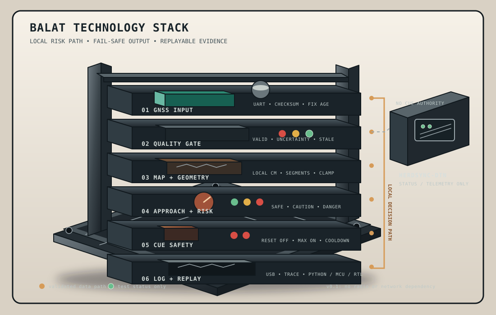

# BALAT v2: Offline Road-Risk Validation for Free-Grazing Livestock

**Pitch status:** Pre-seed validation / research prototype  
**Current evidence:** RTL simulation, synthetic trace replay, and FPGA bench tests  
**Not yet demonstrated:** Live-GNSS field reliability, animal response, collision prevention, production economics, or paying-customer demand

---

## Slide 1: The question we are solving

### Can livestock near rural roads be warned early enough without cellular infrastructure or painful stimuli?

BALAT is a research prototype for offline road-risk detection on a livestock
wearable.

- Local GNSS position and preloaded road geometry.
- Deterministic road-distance and approach-risk calculation.
- Conservative, output-only cue scheduling.
- Designed for supervised testing with non-aversive dummy cues.
- No claim yet that a cue will reliably change livestock behavior.

**Speaker note**

BALAT is not presented as a proven virtual fence. We are testing whether a
local, offline risk engine can provide useful and safe warnings in rural
areas, and whether livestock can be conditioned to respond without painful
stimuli.

---

## Slide 2: The customer problem

### Free-grazing livestock can approach roads where fencing, supervision, and connectivity are limited

The initial customer problem is narrow:

- Livestock managers oversee cattle that graze near a known road corridor.
- Physical fencing may be expensive, difficult to maintain, or unsuitable for
  large grazing areas.
- A passive tracker can report location but does not locally evaluate approach
  risk or schedule a bounded cue.
- Cellular coverage and fixed gateways may be unavailable or unreliable.

The first customer is likely to be a cooperative, district livestock program,
or managed farmer group rather than an individual farmer buying one collar.

**Evidence still required**

- Confirmed road-corridor incidents and financial impact.
- Customer interviews and pilot commitments.
- Actual coverage and fencing-cost data for the target district.

---

## Slide 3: Why existing approaches are insufficient for this wedge

| Approach | Strength | Limitation for the target problem |
|---|---|---|
| Physical fencing | Direct physical boundary | Capital, maintenance, terrain, and access constraints |
| Human supervision | Flexible and familiar | Limited coverage and inconsistent response time |
| Passive tracking | Location visibility | Usually does not make a local approach-risk decision |
| Connected virtual fencing | Real-time telemetry and established vendors | May require network infrastructure, subscriptions, or behavior-specific validation |
| BALAT prototype | Offline local computation and replaceable cue output | GNSS, map, behavior, economics, and field reliability remain unvalidated |

BALAT is not claiming that every competitor requires the same infrastructure or
uses the same cue method. Competitor comparisons must be verified product by
product.

---

## Slide 4: The proposed product direction

### A local road-risk engine with a supervised cue experiment

The proposed system:

1. Receives GNSS fixes.
2. Rejects invalid, stale, uncertain, or implausible data.
3. Converts position to a local metric coordinate system.
4. Compares the position with locally stored road segments.
5. Estimates whether movement is toward the nearest relevant segment.
6. Enters a conservative risk state.
7. Requests a bounded cue through an external driver interface.
8. Logs the evidence supporting every decision.

The cue is experimental. It is not assumed to steer livestock reliably.

---

## Slide 5: Product architecture

```text
GNSS UART
   |
   v
Fix parser and quality gate
   |
   v
Local coordinate transform
   |
   v
Validated road-segment map
   |
   v
Nearest segment and distance
   |
   v
Approach estimator
   |
   v
Risk state machine
   |
   v
Conservative cue scheduler
   |
   +--> LED / protected driver input / dummy load
   |
   +--> Structured event log

HerdSync-DTN
   |
   +--> Status and telemetry only
       never cue authorization
```

The first behavior-validation build is microcontroller-first. The existing
FPGA remains the deterministic RTL reference for comparison.



**Figure:** A clean physical rack represents the local technology path. GNSS
and quality checks enter at the top, map and geometry feed the risk state,
cue safety bounds the output, and replay logging keeps every decision
inspectable. HerdSync-DTN is separate status/telemetry only. The green
indicators are test status only; the stack does not connect to a real actuator.

---

## Slide 6: What has been demonstrated

### Bench proof, not field or animal proof

Current repository evidence includes:

- Synthesizable road-geometry and risk-state RTL.
- Synthetic local-coordinate trace replay.
- Point-to-segment distance vectors compared with a Python reference.
- Basys 3 timing closure for the demonstration path.
- Basys 3 USB-UART bridge bench testing.
- Structured HerdSync-DTN software scenarios.
- Reset, stale-data, map-fault, cooldown, and cue-gating tests.

Current limitations:

- Live GNSS input and collar mounting are not validated.
- Map completeness and road-edge accuracy are not validated in the field.
- Battery life and enclosure durability are not validated.
- Animal response and habituation are not validated.
- There are no paying customers.

**Evidence sources**

- [`docs/BASYS3_DEMO.md`](../docs/BASYS3_DEMO.md)
- [`docs/BASYS3_HERDSYNC_BRIDGE.md`](../docs/BASYS3_HERDSYNC_BRIDGE.md)
- [`docs/VERIFICATION.md`](../docs/VERIFICATION.md)
- [`PLAN.md`](../PLAN.md)

---

## Slide 7: The riskiest assumption

### Will livestock respond reliably and safely to non-aversive cues?

This is the existential product assumption.

Unknowns include:

- Whether an acoustic or haptic cue can be conditioned without an aversive
  reinforcer.
- Whether response persists after repeated exposure.
- Whether an animal stops, turns, or moves unpredictably.
- Whether a cue is effective across animals, breeds, terrain, and context.
- Whether the cue could create a new safety risk near a road.

The prototype must not claim animal guidance effectiveness before controlled,
welfare-reviewed evidence exists.

**Stage-gate rule**

If animals ignore the cue, habituate, show distress, or move unsafely, stop the
trial and reconsider the product direction.

---

## Slide 8: One-week MCU validation sprint

### Validate behavior and safety before expanding the RTL pipeline

| Day | Main output |
|---|---|
| 1 | STM32 board, GNSS UART, USB console, reset-safe dummy output, event schema |
| 2 | NMEA parser, checksum validation, fix-quality gate, stale handling |
| 3 | Map manifest validation, local coordinates, nearest-segment geometry |
| 4 | Velocity, approach detection, risk FSM, hysteresis, jump rejection |
| 5 | Cue scheduler, manual disable, fault manager, structured logging |
| 6 | Deterministic replay, MCU/Python/RTL comparison, bench soak |
| 7 | Reproducible demo, evidence report, FPGA continuation decision |

The sprint does not include animal testing, production hardware, radio
integration, or real actuators.

---

## Slide 9: Recommended prototype platform

### STM32L476RG Nucleo

Recommended for the one-week behavior prototype because it provides:

- Hardware UART for GNSS.
- USB serial through the development board.
- Timers for deterministic sample and cue ticks.
- Watchdog and brownout/reset support.
- Low-power modes relevant to a future wearable.
- Enough memory for the current map and replay logs.
- Integer and fixed-point arithmetic suitable for RTL comparison.

An ESP32-class board is an acceptable fallback only if the existing team
toolchain is significantly faster there. Wi-Fi and BLE should remain disabled
on the local risk path.

---

## Slide 10: Safety behavior

The device must fail to a non-cueing state when:

- GNSS checksum or sentence parsing fails.
- The receiver reports no fix.
- The fix becomes stale.
- Position timestamps stop or move backward.
- Position jumps beyond a configured plausible speed.
- Uncertainty is too large for the configured road buffer.
- The map is empty, corrupt, out of range, or version-mismatched.
- The MCU resets, browns out, or enters a watchdog recovery.
- Manual disable is active.

The cue output is:

- Output-only.
- Inactive on reset.
- Limited to a hard maximum duration.
- Protected by a mandatory quiet interval.
- Connected only to an LED, logic analyzer, or protected driver input.

No FPGA or MCU GPIO directly powers a motor or speaker.

---

## Slide 11: Data and map contract

Each map record contains:

```text
segment_id
ax_cm, ay_cm
bx_cm, by_cm
ux_q14, uy_q14
road_class
source_id
buffer_cm
valid
```

The manifest records:

- Source and applicable ODbL attribution.
- Extraction timestamp.
- Bounding box.
- Local coordinate origin and projection.
- Coordinate unit and width.
- Simplification tolerance.
- Segment count and maximum count.
- Direction format.
- Map version and checksum.

The current prototype reuses the repository’s local-centimetre map fixture and
synthetic traces. Private farm coordinates are not added during this sprint.

---

## Slide 12: Logging and reproducibility

Every decision is associated with:

```text
firmware_version
map_version
fix_sequence
timestamp
fix_valid
quality
uncertainty
local_x_cm, local_y_cm
nearest_segment_id
distance2_cm2
approaching
risk_state
fault_reason
cue_requested
cue_started
cue_stopped
cue_duration_ms
reset_reason
```

The same trace should run through:

1. The Python reference model.
2. The MCU replay harness.
3. The RTL trace player.

The goal is not identical clock latency. The goal is identical functional
decisions at the configured sample boundary, within documented numeric
tolerances.

---

## Slide 13: Business model hypothesis

### Start with a paid validation and deployment service, not assumed SaaS

Initial commercial hypothesis:

- Hardware is supplied as part of a supervised pilot.
- Customer pays for map preparation, installation, configuration, and support.
- Offline device operation continues without a network subscription.
- Optional annual service covers map updates, device management, data export,
  and risk reports.

Pricing is not validated. The earlier Rp 2.4 million collar price and Rp
500,000 annual service price are target assumptions, not confirmed market
prices.

Before final pricing, measure:

- Willingness to pay.
- Pilot-to-paid conversion.
- Collar loss and repair rate.
- Installation and support cost.
- Map-maintenance effort.
- Subscription renewal intent.

---

## Slide 14: Market entry

### Start with a narrow, reachable beachhead

Initial target:

> A cooperative, district livestock program, or managed farmer group with
> free-grazing cattle near a documented road corridor and a responsible local
> supervisor.

First acquisition channels:

- Livestock cooperatives and farmer groups.
- District livestock agencies.
- Veterinary and animal-welfare partners.
- Research institutions with approved test facilities.
- Road-safety or agricultural-risk programs.

Pilot funnel:

```text
Discovery interviews
        |
        v
Site and map assessment
        |
        v
5-20 device supervised pilot
        |
        v
Behavior, GNSS, and operations evidence
        |
        v
Paid group deployment only after stage gates
```

Do not use “no collision occurred” as the sole pilot success metric. Collisions
are too infrequent for a short pilot to prove prevention.

---

## Slide 15: Market sizing method

### Use a bottom-up model before a global TAM headline

Calculate the beachhead from:

```text
reachable farmer groups
× eligible free-grazing cattle per group
× expected pilot/adoption rate
× hardware revenue
```

Then model service revenue separately:

```text
active devices
× service attach rate
× annual service price
× renewal rate
```

The previous market draft contained inconsistent cattle totals and unit counts.
The revised model must reconcile:

- Regional cattle population.
- Cattle actually near eligible road corridors.
- 15,000 versus 25,000 three-year device assumptions.
- Hardware price, service price, attach rate, and renewal rate.

Until reconciled, label TAM, SAM, and SOM as market hypotheses.

---

## Slide 16: Competition and defensibility

### Defensibility must be earned through evidence

Potential future advantages:

- Validated road-risk datasets from difficult rural environments.
- Map correction and deployment workflows for private or missing roads.
- Field-tested safety policies for uncertainty and stale GNSS.
- Evidence-backed cue-conditioning protocols.
- Reliable device operations in connectivity-poor areas.
- Integrations with local cooperatives and livestock programs.

Do not currently claim:

- “The only” offline humane collar.
- A patent moat without a documented filing.
- That incumbents cannot copy the feature.
- That competitor products all require the same network or cue method.

The current technical architecture is a prototype advantage, not yet a durable
commercial moat.

---

## Slide 17: Stage-gated roadmap

### Fund evidence in the order that reduces risk

#### Gate 0: Deterministic bench behavior

- Parser, map, geometry, risk, and cue scheduler agree across Python, MCU, and
  RTL.
- All stale, corrupt, and invalid inputs fail safe.

#### Gate 1: GNSS and map performance

- Measure fix availability, uncertainty, jumps, and latency in target
  environments.
- Verify road geometry, road width, and missing-road correction workflow.

#### Gate 2: Welfare-reviewed behavioral study

- Approved protocol and enclosed test area.
- Positive conditioning and non-aversive cues.
- Predefined response, distress, habituation, and stop criteria.

#### Gate 3: Customer and operations validation

- Confirmed pilot partner.
- Installation, collar retention, support, and data workflow measured.
- Willingness to pay and renewal intent recorded.

#### Gate 4: Limited supervised field pilot

- Only after the earlier gates pass.
- No claim of accident prevention until evidence supports it.

Failure at any gate triggers a pause or pivot rather than automatic scale-up.

---

## Slide 18: Financial planning principles

### Replace unsupported forecasts with explicit assumptions

The financial model must show:

- Units shipped and active.
- Pilot discounts and paid conversions.
- Hardware ASP.
- Fully loaded COGS, not component BOM alone.
- Assembly, testing, packaging, freight, warranty, and repair.
- Map preparation and installation.
- Support and field operations.
- Service attach and renewal rates.
- Inventory and payment timing.
- Certification, tooling, and working capital.

Correct arithmetic must be checked independently. For example:

- 5,000 × Rp 2.4 million = Rp 12.0 billion hardware revenue.
- 5,000 × Rp 500,000 = Rp 2.5 billion annual service revenue before
  attach-rate or renewal adjustments.
- 25,000 × Rp 2.4 million = Rp 60.0 billion hardware revenue.
- 25,000 × Rp 500,000 = Rp 12.5 billion annual service revenue before
  attach-rate or renewal adjustments.

Do not claim cash-flow positivity until inventory and operating cash timing are
modeled.

---

## Slide 19: Funding ask

### Fund the next decision, not an assumed national rollout

The first funding tranche should support:

- One-week MCU behavior and safety prototype.
- GNSS field logging and map validation.
- Customer discovery and pilot-site assessment.
- Welfare-reviewed behavioral study preparation.
- Dummy-cue and protected-driver testing.
- Manufacturing quotations and a fully loaded cost model.

The next tranche should depend on:

- Reliable replay and cross-platform behavior.
- Acceptable GNSS and map performance.
- Approved welfare protocol.
- Repeatable, safe cue response evidence.
- Confirmed pilot partner and willingness to pay.
- Production and support economics.

The previous Rp 4 billion / 18-month request should remain a working scenario
until a detailed budget and stage-gated plan support it.

---

## Slide 20: Definition of progress

### What success looks like before commercialization

Technical:

- Reproducible MCU, Python, and RTL decisions.
- No cue from invalid, stale, corrupt, or uncertain data.
- Measured latency, current, reset, and logging behavior.

Operational:

- Map preparation and correction workflow tested.
- Setup time and collar retention measured.
- Pilot logs are complete and replayable.

Behavioral:

- Welfare review completed before animal testing.
- Response and non-response are measured using predefined criteria.
- Habituation, distress, and unsafe movement are tracked.

Commercial:

- Named pilot partner.
- Buyer and budget identified.
- Target price tested with real customers.
- Service and support burden measured.

---

## Slide 21: Closing

### BALAT is validating a safer question before promising a safer outcome

We are building the offline road-risk engine first:

- Map-aware.
- Conservative.
- Reproducible.
- Output-only.
- Supervised.
- Designed without painful stimuli.

The next decision is not whether to claim that BALAT prevents accidents.

The next decision is whether evidence shows that:

1. GNSS and map data are good enough for the target environment.
2. The risk engine behaves safely under failure.
3. Livestock can respond reliably and safely to the tested cue.
4. A real customer will pay for deployment and support.

Until those gates pass, BALAT remains a promising prototype and research
program, not a proven virtual fence.

**Contact:** Replace with a verified team contact before presentation.
